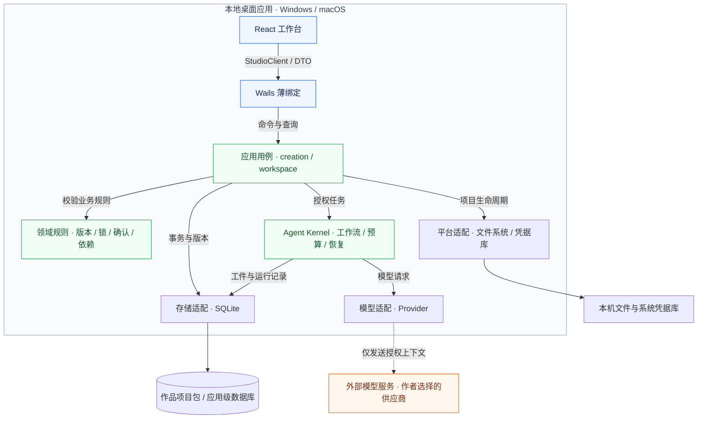
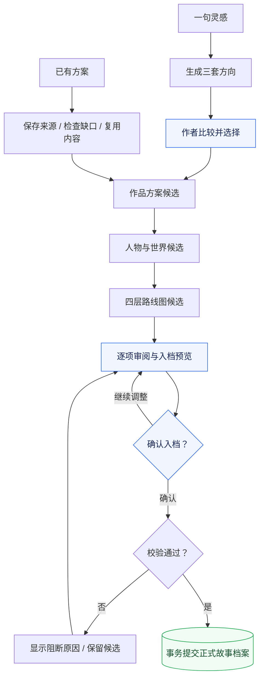
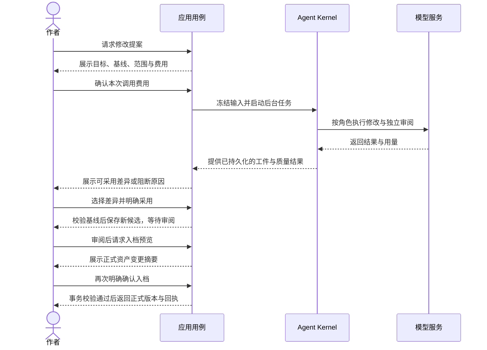
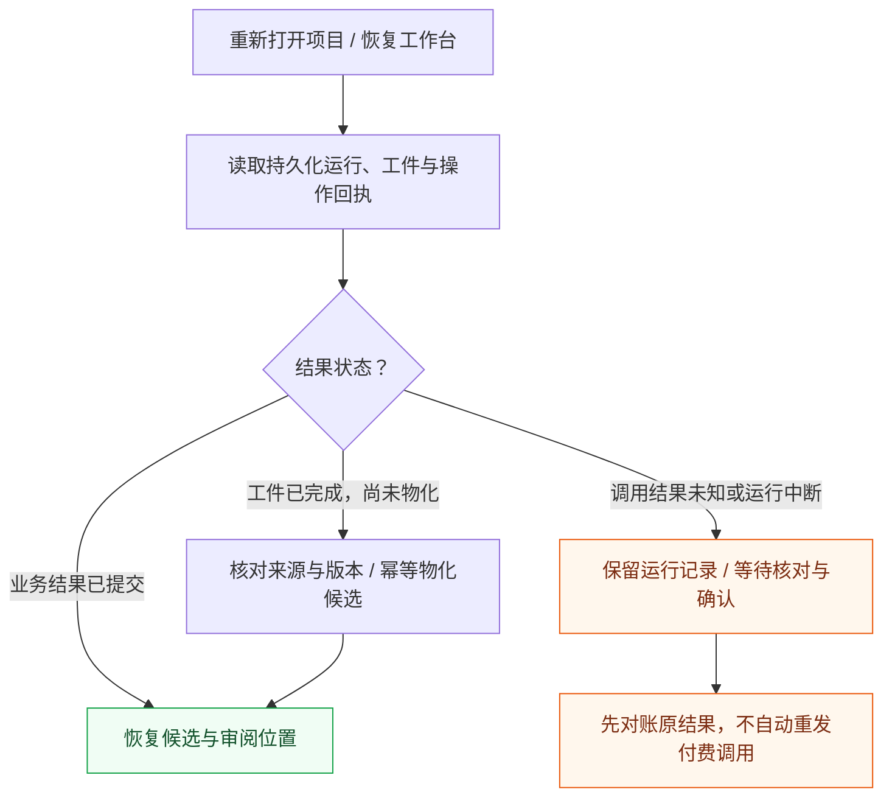
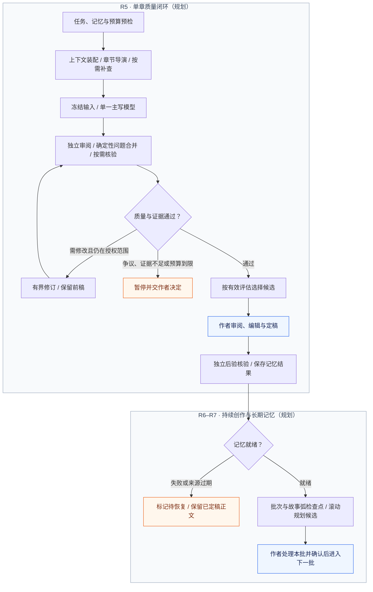

# 织境 Story Studio

面向中文长篇小说作者的本地优先 AI 创作桌面软件，目标平台为 **Windows 与 macOS**。作者可以从一句灵感、已有方案或已有正文开始，让 AI 参与构思、规划、写作与审阅，同时保留对作品方向、设定、正文和版本的最终决定权。

产品围绕一部作品的持续创作组织能力：人物、世界观、大纲、关系、时间线和伏笔共同服务于后续写作；AI 输出先成为可审阅的候选，作者确认后才进入正式档案或正文。

> **研发状态**：R0–R3 已完成，R4「作品策划与正式资产闭环」已按交付边界收尾，下一阶段为 R5「单章高质量写作闭环」。当前仍是研发版本，不是已完成商业发布验收的 V1。阶段状态与验收边界以[开发路线图](docs/product/roadmap.md)为准。

[产品功能](#产品功能) · [架构设计](#架构设计) · [核心功能如何设计](#核心功能如何设计) · [本地数据与隐私](#本地数据与隐私) · [开发运行](#开发运行) · [测试与质量](#测试与质量) · [目录与文档](#目录与文档)

## 产品功能

### 三种创作起点

| 起点 | 作者的输入 | 产品处理方式 | 当前边界 |
| --- | --- | --- | --- |
| 帮我构思 | 一句灵感、题材、情绪目标或约束 | 生成三套方向，经比较与选择后逐步形成方案、人物世界和路线图 | 策划与正式入档已交付；方向后可保存试写准备，真实试写属于 R5 |
| 我已有方案 | 已有构思、大纲、设定或人物资料 | 保留原文与来源，检查缺口，复用合法内容，仅补齐必要项 | 已交付；可以跳过三方向，不伪造阶段接受记录 |
| 我已有正文 | TXT / Markdown 小说 | 先完成编码识别、切章、预览与导入，让作者立即阅读和编辑 | 确定性导入已交付；整书档案抽取与连续性续写准备属于 R8 |

### 当前已交付的能力

| 功能 | 主要能力 |
| --- | --- |
| 本地作品管理 | 创建、打开与最近项目；独立项目包；跨进程占用检测、只读访问、恢复副本及项目切换保护 |
| 创作驾驶舱 | 阶段轨、分类与实体导航、当前对象编辑、分步审阅与自动推进、运行观察、费用确认和重启恢复 |
| 方向与作品策划 | 三方向选择、保留、比较、单卡重做与组合；方案、人物世界和四层路线图生成与编辑 |
| 候选审阅 | 字段锁、逐项接受或排除、版本比较、结构增删、审阅位置恢复；接受、锁定与入档分别操作 |
| AI 共创与修订 | 绑定当前对象的讨论，结构化修改提案、独立审阅、差异展示与显式采用；文本支持部分采用 |
| 正式故事档案 | 方案、大纲、人物与关系、世界设定、时间线与事实、伏笔等结构化资产；策划入档保留身份、层级、锚点和来源 |
| 正式资产持续调整 | 规则、锚点、人物及规划文本按未来章节生效；有限的近期节点新增、停用、故事线改绑与相邻调序 |
| 正文日常编辑 | 自动保存工作稿、保存版本、历史恢复、查找、撤销与重做、字数统计、专注阅读、TXT / Markdown 导出 |
| 模型与运行基础 | OpenAI 兼容及 Anthropic API 适配；角色与模型绑定、版本化创作方案、用量与预算、取消及恢复 |
| 版本与质量工具 | 命名快照、基础剧情分支、可审阅变更集，以及智能体实验室中的固定样本、盲评与回归报告 |

正文编辑与已有 AI 入口可以使用，但不代表 R5 的「生成 → 独立审阅 → 有界修订 → 最终复检 → 定稿 → 后验记忆」完整业务流程已经交付。正式资产调整也有明确范围，不能任意移动跨故事弧节点或改写历史。

### 后续产品主线

| 阶段 | 要完成的能力 |
| --- | --- |
| R5 · 单章创作 | 开篇试写与转正、章节导演、独立审阅、有界修订、最终复检、选区改写与最小后验记忆 |
| R6 · 批次创作 | 默认 3–10 章的有界批次、检查点、暂停恢复、熔断与非破坏性回退、近期路线图滚动更新 |
| R7 · 长篇连续性 | 五层记忆、跨卷召回、证据核验、历史影响分析，以及真实百万字创作验收 |
| R8 · 已有小说档案 | 分章提取、跨章实体合并、整书候选审阅、来源失效和增量重建 |
| R9 · 商业发布 | 双平台签名、公证、安装升级、恢复演练、性能与可访问性、目标作者封闭测试 |
| R10 · 增强能力 | 更大批次、官方订阅运行时、可导入作者模板和工作流、更完整的分支与恢复能力 |

## 架构设计

### 技术栈与选择

| 层次 | 当前基线 | 作用 |
| --- | --- | --- |
| 桌面容器 | Wails v2 | 提供原生窗口、菜单、对话框、生命周期与 Go 绑定 |
| 用户界面 | React、TypeScript、Vite | 展示作品状态、候选、差异、运行进度与编辑界面 |
| 业务与运行时 | Go | 承载领域规则、应用用例、工作区管理、Agent Kernel 与模型适配 |
| 持久化 | SQLite、WAL、Goose 迁移 | 本地事务、版本、来源、作业与可恢复状态 |
| 模型接入 | Provider 适配层 | 统一流式响应、错误、取消与用量，保留异构模型能力 |
| 质量验证 | Go 测试、Vitest、创作质量 Harness | 分别验证业务规则、前端交互及模型输出质量 |

Rust 不是当前必需依赖。只有出现经测量的性能瓶颈、可靠库缺口或原生能力需求时，才考虑带版本化通信协议的隔离 sidecar；不默认增加 Rust FFI。生产基线保持 Wails v2。

### 分层与调用边界

实线表示本地调用或读写，虚线表示外部模型请求；业务模块均运行在同一桌面应用内。



领域层不依赖 Wails、React 或数据库。React 通过应用命令操作作品，不能直接访问 SQLite 或模型供应商；Wails 绑定负责转发和 DTO 转换，不承载核心业务规则。模型也不能绕过应用层写入正式数据。

Go 返回工作台的**权威状态投影**，包括当前阶段、候选、阻断原因、运行状态和允许的动作。前端保留未保存输入及界面偏好，但不靠路由、示例数据或按钮点击自行推断作品是否已经入档。

图表使用 Mermaid，图源与说明一起维护；支持 Mermaid 的 Markdown 阅读器可直接渲染。

[`prototype/`](prototype/) 是已接受的视觉与交互基准。生产界面沿用其设计 Token、布局和组件结构；原型独立运行，不作为生产依赖。未接通能力明确显示未就绪，不能用原型数据伪装成功。

## 核心功能如何设计

### 1. 从创意到正式档案：同一工作台，多条入口

当前策划流程为：



已有方案可复用已提供内容并跳过不适用阶段。每次生成冻结实际选中的上游版本、作者指令和锁定项；上游修改后，只标记相关下游候选过期（`stale`），由作者选择局部重算、保留允许的例外、继续讨论或放弃调整。

「自动推进」只在授权范围内连续生成候选，不代替方向选择和正式确认。重启恢复读取已保存的阶段、版本、审阅位置与运行结果，不自动重发结果未知的付费请求。

### 2. 候选与正式内容隔离：接受不等于入档

系统将作者的三个动作分开：

| 动作 | 改变什么 | 不代表什么 |
| --- | --- | --- |
| 接受候选 | 记录对某个版本或实体的审阅决定 | 不自动锁定字段，也不直接写入正式档案 |
| 锁定字段 | 保护该字段，阻止后续生成或修改越过约束 | 不表示作者已接受整个候选 |
| 确认入档 | 按预览与事务校验提交正式资产及新版本 | 不允许沿用已过期的预览或跳过引用校验 |

正式依据称为 **canonical**，包括作者确认的资产和定稿正文。候选编辑、重新生成和 AI 修订均保留版本与来源；新结果不会静默替换作者正在审阅的内容。

入档先展示创建、更新、排除及锚点摘要，再在短事务内重新核对候选版本、审阅选择、依赖、锁、质量和正式资产当前版本。引用悬空或基线变化即拒绝；中途失败整单回滚。同一幂等请求返回原回执，避免重复创建资产。

### 3. AI 共创：讨论、授权、执行、采用分别处理

共创消息绑定当前作品、阶段、对象、字段和候选版本。讨论可以解释设定或比较方向；涉及内容修改时，先形成结构化提案（`AssistantAction`），显示目标、基准版本、修改范围、保持项、影响和费用。

下图展示策划候选修订的成功路径；费用授权、差异采用和正式入档是独立动作。



修改提案冻结参数与幂等键。确认和采用时再次核对来源；旧版本、锁定冲突、失败或结果未知都有明确状态。采用文本差异时可选择子集，但部分采用形成的新候选需要复核；结构增删必须满足整组采用和引用完整性约束。

生成修改与正式采用是两次不同的决定：付费完成一次模型调用，不意味着作者已同意它修改作品。

### 4. 多模型 Agent Kernel：统一运行，角色独立绑定

当前配置以 `planner`、`writer`、`continuity_reviewer` 三个角色槽为起点，允许规划、写作与审阅使用不同供应商或模型。角色配置与工作流分离，增加能力节点不需要另建运行时，也不把固定 Agent 数量暴露为作者必须操作的步骤。

每次运行冻结任务、输入来源、模型参数、Prompt、Schema、工作流版本和预算，持续保存步骤、输出工件（Artifact）、候选与用量。输出先经过结构和质量校验；「执行成功」与「内容通过审阅」是不同状态。

模型生成质量通过创作质量 Harness 评估：使用固定样本比较直出、初稿和修订稿，结合确定性检查、匿名盲评、接受率、失败率与成本决定是否采用增强工作流。更多模型调用本身不构成质量提升证据。

### 5. 长任务与编辑恢复：防止迟到结果覆盖新内容

模型网络调用不持有阻断正文保存的工作区全局锁。项目作业使用工作区租约（lease）和存储代次标识；项目切换或关闭时先停止接收新作业，再取消或等待在途作业退出，拒绝旧任务向新项目或已关闭存储写回。

任务通过持久化事件（`JobEvent`）与快照投影恢复，前端按游标补拉事件，处理漏推、重复和重新挂载。已经完成的工件可以重新物化为业务候选，但结果未知的外部调用不能直接当作失败后自动重试。

恢复时优先查询已有结果，区分“尚未显示”和“尚未执行”：



编辑侧区分工作稿、保存版本和定稿。自动保存使用串行队列；切章、切项目或退出前先保存，失败保留输入。候选采用和历史恢复也检查当前工作稿，避免覆盖作者刚写入但尚未建立版本的内容。

### 6. 四层规划与按章节生效的修订

路线图采用「全书 → 卷 → 故事弧 → 近期章节」结构：全书维护命题与终局，卷承载阶段目标，故事弧记录因果、人物变化、读者期待、承诺和回报，近期层提供 3–10 章的可执行目标。

规划目标与已发生事实分开保存。「计划在本弧兑现伏笔」不等于正文已经完成兑现；实体和引用使用稳定 ID，不按标题猜测同名人物、卷或章节。

已入档的规则、人物及规划文本调整通过新 revision 保存，并可指定未来空章节作为生效边界（`future_only`）。旧章节继续读取旧版本，不能把未来调整追溯覆盖到历史。当前正式结构只开放经过约束的新增、停用、改绑和相邻调序；完整语义影响、故事内状态变化（`in_story_change`）及追溯改写（`retcon`）属于后续范围。

### 7. 单章、批次与长期记忆的目标设计（R5–R7）

以下是后续实现方向，不能视为当前已交付能力：



- **单章质量**：各审阅者读取同一正文和冻结证据，相互不读取结论；确定性 Finding Merger 只去重、归类和关联证据，不凭空增加问题。修订保留前稿并重新检查，不默认选择最后一版。
- **批次控制**：`GenerationBatch` 协调多个独立 `ChapterRun`，逐章保存输入、候选和恢复点。同批未定稿内容标为临时依据（`provisional`）；检查点遇到严重冲突或预算问题时暂停，回退保留候选和费用记录。
- **上下文可解释**：Context Manifest 记录采用了哪些资产、正文版本与证据，以及选择原因、预算和哈希。由应用层装配输入并控制补查范围，模型不能自由遍历项目。
- **五层记忆**：宪法层保存不可违背约束，结构层保存规划，状态层保存人物与世界变化，摘要层压缩章节信息，证据层保留原文引用。R5 先落地最小后验，R7 再扩展完整体系和长篇容量。
- **事实语义**：人物说过的话、传闻、猜测和不可靠叙述不直接成为客观事实。后验核验保留来源与不确定性；失败不撤销已定稿正文，但会影响下一章生成前的依赖检查。

完整设计及阶段门槛见[产品设计与技术架构](docs/product/architecture.md)和[开发路线图](docs/product/roadmap.md)。

## 本地数据与隐私

每部作品保存在作者选择位置下的独立目录包：

```text
书名.zjproject/
├── project.db      正文、版本、资产、候选、来源与运行记录
├── attachments/    附件
├── exports/        导出文件
├── imports/        导入原文归档
├── branches/       剧情分支资料
└── snapshots/      命名快照与恢复点
```

应用级设置另行保存：模型连接元数据、创作方案版本和最近项目索引不与单部小说混存；API Key 放在操作系统凭据库中，不写入项目包。

SQLite 使用短事务、外键、WAL 和向前迁移；同一项目的可编辑访问由跨进程锁保护。备份或迁移应使用完整项目包和应用恢复能力，不单独复制正在写入的数据库文件。

**本地优先不代表模型调用完全离线。** 作者授权模型任务后，相应的输入、设定或正文上下文会发送到所选模型服务。当前由作者配置自己的 API 连接，模型费用与软件授权分开；调用前展示来源和预算，金额无法估算时明确说明。官方订阅运行时属于后续增强。

仓库与 CI 不保存用户正文、本地数据库、真实模型凭据或签名材料；自动化测试使用 Fake/Recorded Provider，不调用真实模型。诊断信息不应泄露敏感 Prompt、正文或密钥。

## 开发运行

### 环境要求

| 工具 | 仓库要求 |
| --- | --- |
| Go | [`go.mod`](go.mod) 声明最低版本 1.25.7，工具链指令为 `go1.25.12` |
| Wails CLI | v2.13.0，与 Go 依赖保持一致 |
| Node.js | 22，配套 npm 10 或兼容版本 |
| macOS | Xcode Command Line Tools |
| Windows | Go 工具链与 Microsoft WebView2 Runtime |
| Python（仅需相关工具时） | 使用 pyenv 管理的 Python 3.12，不使用系统 Python |

安装 CLI，并将 Go 的可执行文件目录加入 `PATH`：

```bash
go install github.com/wailsapp/wails/v2/cmd/wails@v2.13.0
wails doctor
```

### 启动桌面应用

从仓库根目录安装前端依赖并生成 Go 嵌入资源，再启动 Wails：

```bash
npm --prefix apps/desktop/frontend ci
npm --prefix apps/desktop/frontend run build
cd apps/desktop
wails dev
```

首次体验 AI 策划时，在应用设置中配置模型连接，验证可用性并发布角色方案，然后创建作品并选择「帮我构思」或「我已有方案」。未配置模型时可以操作本地功能，生成入口会提示配置要求。

### 启动浏览器原型

以下命令从仓库根目录执行；原型使用演示状态，不能作为后端已实现的证明：

```bash
npm --prefix prototype ci
npm --prefix prototype run dev
```

### 构建桌面应用

在 `apps/desktop` 下执行，产物位于该目录的 `build/bin`：

```bash
wails build -clean -m
```

`-m` 跳过构建期间的隐式 `go mod tidy`；依赖更新应单独审阅。macOS 与 Windows 的生产构建、绑定检查及产物验证见 [CI 配置](.github/workflows/ci.yml)。本机构建或交叉编译通过不等于目标系统原生交互、旧版本兼容、签名与安装升级验收通过。

## 测试与质量

从仓库根目录执行；首次检出先按上节安装前端依赖：

```bash
npm --prefix apps/desktop/frontend test -- --run
npm --prefix apps/desktop/frontend run typecheck
npm --prefix apps/desktop/frontend run build

go test -count=1 ./apps/desktop ./internal/...
go vet ./apps/desktop ./internal/...

npm --prefix prototype test -- --run
npm --prefix prototype run typecheck
npm --prefix prototype run build
```

并发回归使用与 CI 一致的源码范围和时限：

```bash
go test -count=1 -race -shuffle=on -timeout=15m ./apps/desktop ./internal/...
```

Wails API 改动后，在 `apps/desktop` 重新生成并核验绑定：

```bash
wails generate module
node ../../scripts/ci/verify-wails-bindings.mjs
```

测试按业务价值与风险选择：优先覆盖状态转换、版本冲突、确认事务、幂等、费用授权、并发和恢复，不为简单透传或薄绑定机械增加单元测试。Go 变更需格式化、vet 和相关测试；跨包或并发变更追加全仓及针对性 race。使用显式源码包范围，避免遍历前端依赖目录。

自动化证明协议与业务行为，创作质量 Harness 证明模型效果，真实作者走查与双平台原生验收证明使用体验；三者不能互相替代。R4 收尾验证的结果和限制记录在[功能设计](docs/features/R4/作品策划与正式资产闭环.md)中。

## 目录与文档

| 路径 | 职责 |
| --- | --- |
| [`apps/desktop/`](apps/desktop/) | Wails 入口、薄绑定、菜单及桌面生命周期 |
| [`apps/desktop/frontend/`](apps/desktop/frontend/) | React 页面、类型化客户端、编辑会话与界面状态 |
| [`internal/domain/`](internal/domain/) | 作品、候选、版本、资产、动作及其他领域规则 |
| [`internal/application/`](internal/application/) | 工作区、策划、Agent Kernel、模型配置与质量 Harness 用例 |
| [`internal/agentassets/`](internal/agentassets/) | 版本化 Prompt、Schema、任务和工作流资源 |
| [`internal/providers/`](internal/providers/) | 模型服务适配、流式协议、错误与用量处理 |
| [`internal/persistence/`](internal/persistence/) | 项目、应用设置与 Harness 的 SQLite 持久化 |
| [`internal/platform/`](internal/platform/) | 凭据库、文件系统、项目锁、快照、时钟和 ID |
| [`prototype/`](prototype/) | 独立浏览器原型及视觉、交互契约 |
| [`fixtures/`](fixtures/) · [`tests/`](tests/) · [`scripts/ci/`](scripts/ci/) | 测试资料、验证说明和 CI 检查脚本 |
| [`docs/product/`](docs/product/) | 产品需求、架构与阶段路线图 |
| [`docs/features/`](docs/features/) | 按阶段组织的单一功能设计与验收合同 |

README 是概览与上手入口，详细规则以三份长期权威文档为准：

- [产品需求](docs/product/requirements.md)：用户价值、功能范围、发布边界与产品验收。
- [产品设计与技术架构](docs/product/architecture.md)：交互、领域规则、Agent、数据边界与质量门槛。
- [开发路线图](docs/product/roadmap.md)：阶段顺序、依赖、状态与退出标准。

大型功能使用 `docs/features/R<阶段>/<中文功能名称>.md` 维护同一份设计、实施与验收合同；不另建重复计划。贡献与开发约束见 [AGENTS.md](AGENTS.md)，过时计划和实现历史由 Git 保留。

## 当前限制

- R5–R9 的完整单章质量、批次、长期记忆、整书档案和商业发布能力仍需按阶段实现；百万字容量与叙事连续性尚未完成产品验收。
- 正式资产结构编辑有范围限制，跨故事弧迁移、非相邻批量排序、更广引用改绑与历史语义影响不能通过通用编辑绕过。
- 剧情分支仅支持满足条件的严格快进合并；字段级三方冲突解决尚未交付。
- 当前稿件导出为可编辑项目内的 TXT / Markdown，使用自动保存工作稿；Word / EPUB 与外部另存尚未接通。
- 商业授权方案、正式签名、公证、安装器与自动升级仍未完成；不因开发版本可启动而宣称可商业分发。
